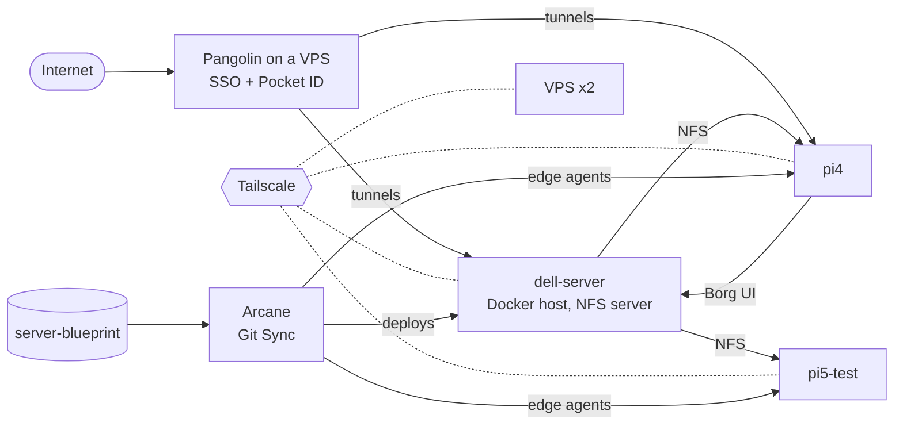

# 🏠 My Homelab

*A small, hands-on self-hosted setup: one mini PC, two Raspberry Pis, two VPSes.*

[Get back in](#-getting-back-into-it) · [Hardware](#-hardware) · [Services](#-services) · [Infrastructure](#-infrastructure) · [Lessons](#-lessons-and-rules) · [Planned](#-planned-and-in-progress) · [Docs](#-docs-and-code) · [History](#-history)

> The *Compose* links open the stack folder in my private `server-blueprint` repo, so they only load for me. Home is behind CGNAT, so everything public goes out through a tunnel (Pangolin), never port-forwards.

## 🚪 Getting back into it

Coming back after a break? Start here.

1. **Read the Handbook first.** Its *What's next* list and *Fix-It* guides say what is open and what to do when something breaks. It is hosted on the Pi 4 and built from a private repo (`homelab-handbook`).
2. **Per-host notes** live in a Claude Project, "Selfhosting Help": a context file and a checklist for each machine. Each file says when it was last checked. If one is over a week old, re-run its refresh steps before trusting it.
3. **Deploying:** edit the stack in `server-blueprint`, merge, and Arcane syncs it. Never edit containers by hand on a host.
4. **Trying something new:** run it on `pi5-test` first, with throwaway secrets, a memory limit and a test port.
5. **Daily and weekly:** check Beszel and the Gotify alerts, confirm last night's Borg run, and look at the Handbook's weekly routine list.
6. **Something is down:** check the Dell first, because the Pis mount its drives over NFS and the backups sit on them.

## 🧭 How it fits together

## 🖥️ Hardware

| Machine | Spec | Role |
|---|---|---|
| **dell-server** | Dell OptiPlex 3060 Micro, i5-8500T, 8 GB, Ubuntu | Main Docker host; exports its drives over NFS |
| **Drives** | 500 GB SSD + two 4 TB USB drives | App data, media, backups |
| **pi4** | Raspberry Pi 4, 8 GB | Backups, files, web terminal, git, ntfy, the Handbook |
| **pi5-test** | Raspberry Pi 5 | Test server: try it here first |
| **VPS x2** | Debian 13 | Public edge (Pangolin) and always-on services |

## 📦 Services

### 🎬 Media
| App | What it does | Compose |
|---|---|---|
| [Jellyfin](https://jellyfin.org/) | Media server | [media_stack](https://github.com/bearded-papa/server-blueprint/tree/main/stacks/media_stack) |
| [Sonarr](https://sonarr.tv/) · [Radarr](https://radarr.video/) · [Prowlarr](https://prowlarr.com/) | TV, movies and indexers | [media_stack](https://github.com/bearded-papa/server-blueprint/tree/main/stacks/media_stack) |
| [qBittorrent](https://www.qbittorrent.org/) | Downloads | [media_stack](https://github.com/bearded-papa/server-blueprint/tree/main/stacks/media_stack) |
| [Seerr](https://github.com/seerr-team/seerr) | Requests for family and friends | [media_stack](https://github.com/bearded-papa/server-blueprint/tree/main/stacks/media_stack) |
| [Cleanuparr](https://github.com/Cleanuparr/Cleanuparr) · [Reclaimerr](https://github.com/jessielw/reclaimerr) | Queue and library tidying | [media_stack](https://github.com/bearded-papa/server-blueprint/tree/main/stacks/media_stack) |

### 📷 Files and photos
| App | What it does | Compose |
|---|---|---|
| [Immich](https://immich.app/) | Photos | [immich](https://github.com/bearded-papa/server-blueprint/tree/main/stacks/immich) |
| [OpenCloud](https://opencloud.eu/) | File sync and sharing | [opencloud](https://github.com/bearded-papa/server-blueprint/tree/main/stacks/opencloud) |
| nextExplorer | Web file manager | [nextexplorer](https://github.com/bearded-papa/server-blueprint/tree/main/stacks/nextexplorer) |

### 🧰 Everyday
| App | What it does | Compose |
|---|---|---|
| [Mealie](https://mealie.io/) | Recipes | [mealie](https://github.com/bearded-papa/server-blueprint/tree/main/stacks/mealie) |
| GeoPulse | Self-hosted location timeline | [geopulse](https://github.com/bearded-papa/server-blueprint/tree/main/stacks/geopulse) |
| Bus tracker | Live bus map using Bus Open Data Service | [bus-tracker](https://github.com/bearded-papa/server-blueprint/tree/main/stacks/bus-tracker) |

### 🛠️ Ops
| App | What it does | Compose |
|---|---|---|
| [Homepage](https://gethomepage.dev/) | The dashboard this page is modelled on | [homepage](https://github.com/bearded-papa/server-blueprint/tree/main/stacks/homepage) |
| [Arcane](https://getarcane.app/) | Docker deployments from Git | — |
| [Beszel](https://beszel.dev/) | Host monitoring | [beszel](https://github.com/bearded-papa/server-blueprint/tree/main/stacks/beszel) |
| Scrutiny | Drive SMART health | [scrutiny](https://github.com/bearded-papa/server-blueprint/tree/main/stacks/scrutiny) |
| Borg UI | Backups | [borg-ui](https://github.com/bearded-papa/server-blueprint/tree/main/stacks/borg-ui) |
| [Gotify](https://gotify.net/) · [ntfy](https://ntfy.sh/) | Notifications | [gotify](https://github.com/bearded-papa/server-blueprint/tree/main/stacks/gotify) · [ntfy](https://github.com/bearded-papa/server-blueprint/tree/main/stacks/ntfy) |
| Termix | Web SSH | [termix](https://github.com/bearded-papa/server-blueprint/tree/main/stacks/termix) |

### 🔐 Edge and identity
| App | What it does | Compose |
|---|---|---|
| [Pangolin](https://github.com/fosrl/pangolin) | Tunnelled public access with SSO | [pangolin-site](https://github.com/bearded-papa/server-blueprint/tree/main/stacks/pangolin-site) |
| [Pocket ID](https://pocket-id.org/) | Passkey login (OIDC) | [pocket-id](https://github.com/bearded-papa/server-blueprint/tree/main/stacks/pocket-id) |
| [Tailscale](https://tailscale.com/) | Private network between the machines | — |

## 🔗 Infrastructure

- **Deploys:** Arcane Git Sync from a private repo of Compose stacks. Bind mounts only, memory limits on heavy containers.
- **Storage:** Pis mount the Dell's drives over NFS.
- **Backups:** Borg, with SQLite apps stopped around the nightly run. Off-site copy is next.
- **Alerts:** Beszel plus UptimeRobot, delivered to Gotify.

## 📏 Lessons and rules

- **Docker bypasses the firewall.** Published ports go around UFW, so bind them to `127.0.0.1` or the Tailscale address, never bare, on anything exposed.
- **One tunnel for everything public.** Pangolin SSO in front by default, Pocket ID where the app supports it.
- **Bind mounts only,** with absolute paths, and appdata under one folder per host. SQLite databases go on local disk, not NFS.
- **Stop SQLite apps around the backup,** dump Postgres, and let apps that make their own zips run.
- **Memory limits** on every heavy container; the Dell only has 8 GB.
- **Test first** on the spare Pi, and decide by a date written in the first line of the test stack.
- **Secrets** stay out of this repo. Placeholders in `.env` files are checked with `grep -c PASTE`, never by reading the file.
- **Prove it:** a check only counts when its output has been seen, and a script is a draft until it has run.

## 🔭 Planned and in progress

- Off-site Borg copies (a second job to a remote repo, after Postgres dumps are set up)
- Retiring Gitea for Forgejo (Forgejo is live; mirrors are being added)
- Pi 4 boot drive: SD card to SSD
- Ansible playbooks for the machines, with a web UI
- Trying a DNS resolver and a private search engine on the test Pi

## 📚 Docs and code

| What | Where |
|---|---|
| Git hosting | Forgejo (moving over from Gitea), mirroring from GitHub, stack: [forgejo](https://github.com/bearded-papa/server-blueprint/tree/main/stacks/forgejo) |
| Homelab Handbook | Interactive fix-it guides, checklists and rebuild steps, hosted on the Pi 4 ([repo](https://github.com/bearded-papa/homelab-handbook), stack: [handbook](https://github.com/bearded-papa/server-blueprint/tree/main/stacks/handbook)) |
| Bus tracker | Private repo, hosted on the Pi 4 |
| This profile | [previous_setups.md](previous_setups.md) lists apps I tried and dropped |

## 🕰️ History

Earlier versions ran on [Komodo](https://komo.do/), with Dockge before that. The old README is kept in [README_OLD.md](README_OLD.md). The move to Arcane, Pangolin and Pocket ID came in autumn 2026.
